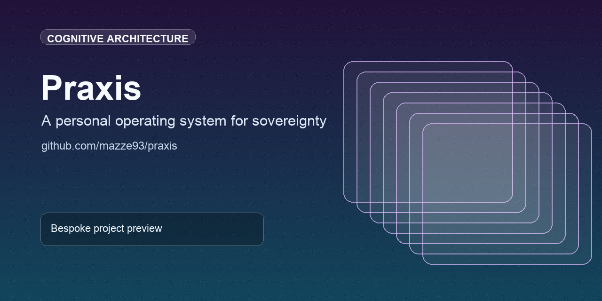

# Praxis

## At a glance

Praxis is a personal operating system built around one premise: identity, memory, and trust should be owned locally, not rented from a cloud vendor. Four interdependent layers form the stack rather than four disconnected tools.

- **Unified control plane** — switching context in DAEDALUS also restores your ContextSynapse cognitive profile, so state travels with identity.
- **Privacy as structure** — no component has a required cloud dependency; ContextSynapse persists locally.
- **Trust is enforced, not assumed** — Aegis gates agent actions through session verification, identity lock, policy resolution, and redaction.

### Build status

| Status | Component |
|:---:|---|
| ✅ | DAEDALUS context switching |
| ✅ | ContextSynapse Bayesian engine |
| ✅ | DAEDALUS ↔ ContextSynapse integration |
| ✅ | Aegis enforcement gateway |
| ⬜ | Aegis backend tool routing |
| ⬜ | DAEDALUS → Aegis session auto-init |
| ⬜ | Cross-device encrypted sync |
| ⬜ | Installer / bootstrap script |

## Quick links
- [What Praxis Is](#what-praxis-is)
- [Design Principles](#design-principles)
- [Architecture](#architecture)

## What Praxis Is

A layered system of interdependent components, each solving one part of the sovereignty problem:

| Layer | Component | What it owns |
|-------|-----------|-------------|
| Identity | [DAEDALUS](https://github.com/mazze93/daedalus-switch) | *Who* you are in a given context — operationally, securely |
| Cognitive | [ContextSynapse](https://github.com/mazze93/context-synapse) | *What you know and remember* — adaptively, locally |
| Voice | [mazze-leczzare-blog](https://github.com/mazze93/mazze-leczzare-blog) | How the system and its philosophy speak outward |

---

## Design Principles

**1. Local-first is non-negotiable.**
Your cognitive substrate lives on your hardware. 
No required cloud dependency. 
No third-party custody of your context.

**2. Privacy is the architecture, not a feature.**
Every component is built privacy-first at the structural level. 
It cannot be bolted on afterward.

**3. Cognitive accessibility is a first-class requirement.**
ADHD-accessible design throughout. 
One command, not ten steps. 
Minimal decision overhead. 
Context that follows you instead of requiring you to reconstruct it.

**4. Sovereignty requires composability.**
The layers must integrate. 
Switching identity context (DAEDALUS) should carry cognitive context (ContextSynapse). 
Components that don't talk to each other leave gaps that surveillance fills.

---

## Status

Praxis is an emerging system. The components exist and function independently.
The integration layer — the connective tissue that makes them a unified OS — is the next frontier.

## Start here

If you want to see working code rather than architecture, start with:

- [daedalus-switch](https://github.com/mazze93/daedalus-switch) — the shipped CLI: one command switches VPN, terminal, and filesystem context
- [stratum](https://github.com/mazze93/stratum) — epistemic decision ledger with a live demo at [stratum.mazzeleczzare.com](https://stratum.mazzeleczzare.com)

